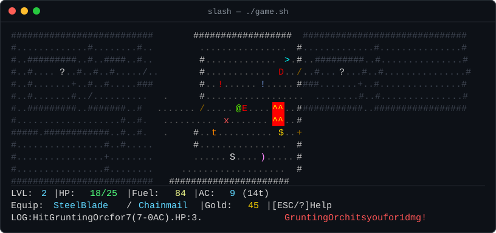

# slash

A data-driven terminal roguelike engine written in pure Bash, inspired by the
classic 1980s UNIX dungeon crawlers
[*Hack*](https://en.wikipedia.org/wiki/Hack_(video_game)) and
[*NetHack*](https://www.nethack.org/).

Where *Hack* and *NetHack* gave us the `@` adventurer, `+` doors, `!` potions,
`)` weapons, `[` armor, and `$` gold piles—and decades of C source—`slash`
brings the other half of *hack and slash* to a single Bash script with raycast
torchlight, 256-color glyphs, and zero compiled dependencies.

`slash` is built for **vibe coding**: all monster, equipment, and item balance
lives in a plain-text table ([`game.cfg`](game.cfg)), so you can invent new
creatures and loot without touching a line of engine code.



## Quick Start

Run the smart Docker launcher:

```sh
./slash
```

`./slash` automatically builds the container image (running the test suite
during `docker build`) whenever `game.sh`, `game.cfg`, `test.sh`, or
`Dockerfile` change, then launches the game in an interactive terminal.

To run directly on the host (requires Bash 4+):

```sh
./game.sh
```

### Controls

| Key | Action |
| :--- | :--- |
| `w` `a` `s` `d` / Arrow Keys | Move, bump-attack monsters, or open closed doors (`+`) |
| `,` | Pick up the item at your feet into your pack (gold is collected immediately) |
| `i` | Open Inventory to use or equip carried items (`1`–`9` to select; identifies item type) |
| `>` | Descend staircase (`>`) to the next dungeon floor |
| `.` | Wait a turn |
| `ESC` / `?` | Open Help menu (or cancel an active prompt/modal; `Space` also closes Help) |
| `q` | Quit (prompts for confirmation `[y/n]`, or quits immediately from Help) |
| `Q` / `Ctrl-C` | Quit immediately |
| `v` | Toggle debug visibility |

### Map Symbols & Hazards

| Symbol | Meaning |
| :--- | :--- |
| `@` | Player |
| `>` | Stairs down to the next dungeon floor |
| `#` / `.` | Dungeon wall / floor |
| `+` / `/` | Closed door (blocks sight) / Open door |
| `^` | Lava (deals burn damage on contact) |
| `x` | Triggered trap (or hidden trap when `DEBUG=1`) |
| `?` | Previously seen entity outside current torchlight FOV |
| `!` border | Low-HP danger alert (`<= 30%` max HP) |

## Configuration (`game.cfg`)

Entities are uniquely identified by their `SYM` + 256-color `COLOR` pair,
allowing multiple items or monsters to share the same ASCII glyph with
different colors (for example, red and blue `!` potions).

```text
TYPE | SYM | COLOR | NAME | HP | DAMAGE | ATTACK | AC | VALUE
```

Use `-` for unused numeric columns.

| Type | Description | Active Columns |
| :--- | :--- | :--- |
| `MON` | Monster | `HP` (health), `DAMAGE` (melee attack), `AC` (damage reduction), `VALUE` (HP regen per turn) |
| `WEP` | Weapon | `ATTACK` (bonus added to player base attack) |
| `ARM` | Armor | `AC` (reduces incoming monster melee damage) |
| `POT` | Potion | `HP` (instant heal) or `AC` + `VALUE` (temporary AC boost and turn duration) |
| `TOR` | Torch | `VALUE` (fuel turns added to torchlight FOV) |
| `GOL` | Gold | `VALUE` (maximum gold dropped on pickup) |

## Development & Testing

You can run checks and builds through either `./slash` flags or `make`:

```sh
./slash         # or: make run         (build image if needed and launch game)
./slash -t      # or: make test        (run engine + 2D ASCII UI test suite)
./slash -c      # or: make check       (run bash -n, shellcheck, and ./test.sh)
./slash -b      # or: make build       (force Docker image rebuild with test gate)
./slash -s      # or: make screenshot  (render deterministic screenshot.svg)
./slash -h      # show CLI options
make lint       # run bash -n and shellcheck only
make hooks      # configure git core.hooksPath -> .githooks
```

### Debugging & Deterministic Rendering

- `DEBUG=1 ./game.sh` disables fog-of-war and reveals hidden traps (`x`).
- `FLICKER=0 ./game.sh` disables torchlight color jitter for deterministic
  ASCII/ANSI snapshot testing.

### Git Hooks & CI

Running `./slash`, `./test.sh`, or `make hooks` automatically points
`git config core.hooksPath` at [`.githooks/`](.githooks):

- **`pre-commit`**: Verifies Bash syntax (`bash -n`), runs `shellcheck` (if
  installed), and executes `./test.sh`.
- **`commit-msg`**: Enforces Conventional Commits (`type(scope): Subject`) and
  the 50/72 line-length rule.
- **`pre-push`**: Runs `./test.sh` before pushing.

If you use the [`pre-commit`](https://pre-commit.com/) framework or
[`act`](https://github.com/nektos/act) (`gh act`),
[`.pre-commit-config.yaml`](.pre-commit-config.yaml) and
[`.github/workflows/ci.yml`](.github/workflows/ci.yml) are also configured out
of the box.

## Roadmap

- [x] **Monster HP & Armor Class:** Multi-hit combat and `AC` damage mitigation
  for both monsters and the player.
- [x] **Timed Buffs:** `Potion of Protection` (`AC_BOOST` / `AC_TIMER`).
- [ ] **Experience (XP):** Gain levels and permanent stat boosts through
  combat.
- [x] **Identify Mechanics:** Hide item stats until they are used or
  identified (or revealed on the post-mortem screen).
